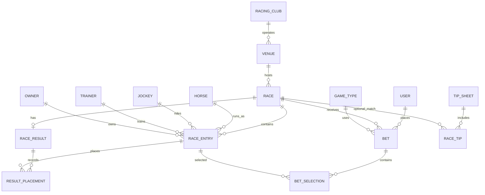

# Backend and Frontend Integration Guide

This guide describes the API and data model currently implemented in this repository. It is written for frontend developers integrating a web or mobile client with the Django REST API.

## 1. Base URL and request conventions

The API is versioned under `/api/v1/`.

```text
Local: http://127.0.0.1:8000/api/v1
```

Use the deployed API host in production. Configure the frontend origin in the backend's `CORS_ALLOWED_ORIGINS` setting. Send JSON requests with `Content-Type: application/json`. Dates use `YYYY-MM-DD`; timestamps are ISO 8601. The configured timezone is Asia/Manila, while timestamps are stored in UTC.

Most list endpoints use this pagination envelope (default page size 20, maximum 100):

```json
{
  "count": 35,
  "next": "https://api.example.test/api/v1/races/?page=2",
  "previous": null,
  "results": []
}
```

Use `?page=2&page_size=50`. The meetings endpoint, race notes list, and the games endpoint return unpaginated data. Decimal values are JSON strings, so parse them as decimal values if doing arithmetic.

## 2. Authentication and access

Protected endpoints accept a JWT access token:

```http
Authorization: Bearer <access-token>
```

Access tokens last five minutes by default. The refresh flow depends on `AUTH_BEARER_ONLY`:

- **Cookie refresh mode (default):** login/register set an HttpOnly refresh cookie. The browser must send credentials and CSRF headers for login, registration, refresh, and logout. First call `GET /auth/csrf/`, preserve the cookie, and send the returned `csrfToken` in `X-CSRFToken` on those requests. Refresh rotates the cookie.
- **Bearer-only mode:** no refresh cookie is issued and the CSRF check is disabled for auth requests. On logout the frontend discards its access token. `POST /auth/token/refresh/` returns 410.

| Access level | Routes |
|---|---|
| Public | Health, auth bootstrap/login/register, venues, meetings, races, entries, tips, jockeys, trainers, results, games, race games |
| Signed-in user | `GET/PATCH /me/`, racing clubs, horse profiles, race notes, bets, favorites, notifications |
| Admin or steward | `POST /races/{id}/settle/` |

The default permission is authenticated. Endpoints explicitly marked public override that default. Public and signed-in data endpoints are read-only except where this guide lists write methods.

## 3. Endpoint index

All paths below are relative to `/api/v1`.

| Method | Path | Access | Purpose |
|---|---|---|---|
| GET | `/health/` | Public | Check application/database health and demo-data notice. |
| GET | `/auth/csrf/` | Public | Start cookie-mode browser CSRF flow. |
| POST | `/auth/register/` | Public | Create an account and return an access token. |
| POST | `/auth/login/` | Public | Sign in with email and password. |
| POST | `/auth/token/refresh/` | Public/cookie | Rotate refresh cookie and return a new access token; disabled in bearer-only mode. |
| POST | `/auth/logout/` | Public/cookie | Revoke the refresh token and clear its cookie; in bearer-only mode, discard access token client-side. |
| GET | `/me/` | Token | Read the signed-in profile. |
| PUT, PATCH | `/me/` | Token | Update profile fields allowed by the serializer. |
| GET | `/venues/` | Public | List active race venues and course/surface/facility information. |
| GET | `/venues/{id}/` | Public | Read one venue. |
| GET | `/racing-clubs/` | Token | List racing clubs. |
| GET | `/racing-clubs/{id}/` | Token | Read one racing club. |
| GET | `/meetings/` | Public | Group races into venue/date meetings. |
| GET | `/races/` | Public | Browse the race schedule. |
| GET | `/races/{id}/` | Public | Read race details and its entries. |
| GET | `/races/{id}/entries/` | Public | Read the entries in one race. |
| GET | `/entries/` | Public | Search race entries across races. |
| GET | `/entries/{id}/` | Public | Read one race entry. |
| GET | `/tips/` | Public | Read tip sheets and selections. |
| GET | `/race-notes/?race_id={id}` | Token | List notes for one race. `race_id` is required. |
| GET | `/race-notes/{id}/` | Token | Read one note. |
| POST | `/race-notes/` | Token | Add a race note. |
| PUT | `/race-notes/{id}/` | Token | Update note fields (partial fields are accepted). |
| DELETE | `/race-notes/{id}/` | Token | Delete a note. |
| GET | `/horses/` | Token | Search active horse profiles. |
| GET | `/horses/{id}/` | Token | Read one horse profile. |
| GET | `/jockeys/` | Public | Search active jockey profiles. |
| GET | `/jockeys/{id}/` | Public | Read one jockey. |
| GET | `/trainers/` | Public | Search active trainer profiles. |
| GET | `/trainers/{id}/` | Public | Read one trainer. |
| GET | `/results/` | Public | Browse race results. |
| GET | `/results/{id}/` | Public | Read one result by result database ID. |
| GET | `/races/{id}/results/` | Public | Read the result for one race (404 until it exists). |
| GET | `/games/` | Public, if betting API enabled | Browse active betting-game rules. |
| GET | `/games/{id}/` | Public, if betting API enabled | Read one game's rules. |
| GET | `/games/wager_presets/` | Public, if betting API enabled | Read active suggested wager amounts. |
| GET | `/races/{id}/games/` | Public, if betting API enabled | Read games open for one race. |
| GET | `/bets/` | Token, if betting API enabled | List the signed-in user's tickets. |
| POST | `/bets/` | Token, if betting API enabled | Place a simulated ticket. |
| GET | `/bets/{ticket_number}/` | Token, if betting API enabled | Read one of the signed-in user's tickets. |
| POST | `/races/{id}/settle/` | Admin/steward, if betting API enabled | Finalize result and settle pending demo tickets. |
| GET | `/favorites/` | Token | List favorites; optional `type` filter. |
| POST | `/favorites/` | Token | Add a horse, jockey, trainer, race, or venue favorite. |
| DELETE | `/favorites/{id}/` | Token | Remove a favorite. |
| GET | `/notifications/` | Token | List the signed-in user's notifications. |
| GET | `/notifications/unread_count/` | Token | Get unread notification count. |
| POST | `/notifications/{id}/read/` | Token | Mark one notification read. |
| POST | `/notifications/read_all/` | Token | Mark all notifications read. |

The betting routes are mounted only when `ENABLE_BETTING_API=1` (the default in settings). If disabled, games, bets, race games, and settlement routes are unavailable.

## 4. Endpoint details

### Health

`GET /health/` returns HTTP 200 when Django and the database respond, or HTTP 503 when the database probe fails.

```json
{
  "status": "ok",
  "database": "ok",
  "api_version": "v1",
  "time": "2026-10-17T12:00:00+08:00",
  "data_notice": "Demo data. Not official or live racing information."
}
```

### Authentication and profile

`GET /auth/csrf/` returns `{"csrfToken":"..."}` and sets a CSRF cookie.

`POST /auth/register/` body:

```json
{
  "first_name": "Ana",
  "last_name": "Santos",
  "email": "ana@example.com",
  "mobile_number": "+639171234567",
  "password": "a-strong-password",
  "accept_terms": true
}
```

Registration requires a unique email, a password accepted by Django's password validators (minimum eight characters), and `accept_terms: true`. Success is HTTP 201 and includes `access`, `token_type`, and `user`.

`POST /auth/login/` accepts either `email` or `username` with `password`:

```json
{"email":"ana@example.com","password":"a-strong-password"}
```

Success returns `{"access":"...","token_type":"Bearer"}`. In cookie mode the refresh token is set as an HttpOnly cookie and is not included in JSON.

`POST /auth/token/refresh/` takes no JSON body in cookie mode; send the refresh cookie and CSRF token. It returns a new access token. In bearer-only mode it returns 410.

`POST /auth/logout/` takes no JSON body. Success is HTTP 204. In cookie mode the refresh token is blacklisted and the cookie cleared. In bearer-only mode there is no server-side access-token revocation; clear it from frontend storage.

`GET/PATCH /me/` returns/updates `first_name`, `last_name`, `mobile_number`, and `avatar_url`. `id`, `email`, `role`, and `initials` are read-only. Example response:

```json
{
  "id": 7,
  "first_name": "Ana",
  "last_name": "Santos",
  "email": "ana@example.com",
  "mobile_number": "+639171234567",
  "avatar_url": null,
  "initials": "AS",
  "role": "user"
}
```

### Venues, meetings, races, entries

`GET /venues/?search=metro` searches venue names. Venue response data includes `club_name`, `surfaces`, `courses`, and `facilities`. `GET /racing-clubs/?search=...` searches club names but requires an access token.

`GET /meetings/?date=2026-10-17&venue=2` groups races by venue and date. There is no meeting table: each meeting is derived from races. Each row contains `venue_id`, `venue_name`, `race_date`, `race_count`, and `first_post_time`. Results are unpaginated.

`GET /races/` supports `date`, `status`, `venue`, and `featured=1|true`. Status values are `upcoming`, `ongoing`, `completed`, `cancelled`, and `postponed`. A race list item contains:

```json
{
  "id": 18,
  "race_number": 1,
  "name": "Saturday Feature",
  "race_date": "2026-10-17",
  "post_time": "2026-10-17T13:30:00+08:00",
  "distance_m": 1200,
  "surface": "turf",
  "track_condition": "good",
  "status": "upcoming",
  "entries_count": 8,
  "purse_amount": "120000.00",
  "purse_currency": "PHP",
  "is_featured": false,
  "is_live": false,
  "hero_image_url": null,
  "venue_name": "Metro Turf",
  "club_name": "MMTCI",
  "is_demo": true
}
```

`GET /races/{id}/` adds `description`, `age_restriction`, and `entries`. A race entry includes `id`, `race_id`, `horse_id`, `horse_number`, `badge_color`, `horse_name`, `horse_photo`, `jockey_name`, `trainer_name`, `owner_name`, `weight_kg`, `current_odds`, and `status`. Entry status values are `confirmed`, `pending`, `scratched`, `withdrawn`, and `reserve`.

`GET /races/{id}/entries/` returns an unpaginated array. `GET /entries/?race={raceId}&horse={horseId}` returns paginated entries and can filter by race and/or horse. Entry IDs, rather than horse profile IDs, are required when placing a bet.

### Tips

`GET /tips/?date=2026-10-17` returns tip sheets and their selections. Each sheet has `title`, `race_date`, `compiler`, `source`, `disclaimer`, and `tips`. Each tip has `race_number`, `tipster`, `raw_selection`, parsed `horse_numbers` (empty when unclear), optional `race_id`, `matched_entries`, and `note`. Tips can exist before the official race card is loaded. Once a tip is linked to a race and parsed numbers match entries, `matched_entries` supplies `entry_id`, `horse_number`, and `horse_name`.

### Race notes

Race notes require a Bearer token. `GET /race-notes/?race_id=18` is required to list notes. The create body is:

```json
{"race_id":18,"author":"Steward","content":"Inquiry into the finish","is_flagged":false}
```

The backend automatically flags content containing `foul`, `inquiry`, `disqualified`, or `injury`. Response fields are `id`, `race_id`, `author`, `content`, `is_flagged`, `created_at`, and `updated_at`. The list returns a raw JSON array rather than a pagination envelope.

### Horses and participants

`GET /horses/?search=gold` and horse detail require a Bearer token. Only active horse profiles are listed. Horse fields include identity, photo, sex, color, birth year, country, sire/dam, owner/trainer names, career starts/wins/places, recent form, bio, and `is_fictional`.

`GET /jockeys/?search=...` and `/trainers/?search=...` are public and include active profiles. Jockeys expose name, photo, weight, career stats, bio, and `is_fictional`; trainers expose name, photo, and bio.

### Results

`GET /results/?date=2026-10-17&status=official` filters by race date and result status (`provisional`, `official`, `cancelled`). `GET /results/{id}/` uses the result record ID. `GET /races/{raceId}/results/` uses the race ID and returns 404 if no result exists.

Result responses include a nested race, `winning_time`, `winning_time_ms`, `track_condition`, `posted_at`, `made_official_at`, `placements`, and `dividends`. A placement has finish position, horse number/name, jockey name, and final odds. A dividend has game code, combination, amount, and unit stake.

### Games and simulated betting

These routes are present only if `ENABLE_BETTING_API=1`. Games are configured in the database. `GET /games/` returns active games with `code`, `name`, description, required selection count, ordered-pick flag, and wager bounds. `/games/wager_presets/` returns active amount values. `/races/{id}/games/` returns active games opened for that race.

`POST /bets/` creates a simulated ticket:

```json
{
  "race": 18,
  "game": "WIN",
  "entries": [42],
  "wager_amount": "50.00"
}
```

`entries` is an array of race entry IDs in pick order. The selected game must be active and open for that race; the race must be upcoming and within its betting window; the wager must fit the game's bounds; the number of unique confirmed entries must match `selections_required`. Success is HTTP 201 and returns ticket number, status, simulated flag, race, game, wager, estimate/payout fields, timestamps, and selections.

`GET /bets/?status=pending` lists the current user's tickets. Valid statuses: `pending`, `won`, `lost`, `void`. `GET /bets/{ticket_number}/` retrieves one of that user's tickets. Users cannot see another user's tickets.

`POST /races/{id}/settle/` is restricted to admins and stewards. It requires a result, makes it official, settles pending tickets, and returns `won`, `lost`, and `payout_total`. This is demo betting only: it does not handle real funds or payouts.

### Favorites and notifications

`GET /favorites/?type=horse` lists the signed-in user's favorites. Types: `horse`, `jockey`, `trainer`, `race`, `venue`. `POST /favorites/` body has `target_type`, exactly one matching foreign key (`horse`, `jockey`, `trainer`, `race`, or `venue`), and optional `notify_on_race`. Example:

```json
{"target_type":"horse","horse":12,"notify_on_race":true}
```

Adding a duplicate favorite returns a validation error. `DELETE /favorites/{id}/` removes a favorite.

`GET /notifications/` lists the user's notifications with type, title, body, deep link, read state, and timestamp. Types include `race_reminder`, `race_started`, `result_posted`, `bet_settled`, `system`, and `promo`. `GET /notifications/unread_count/` returns `{"unread":3}`. `POST /notifications/{id}/read/` marks one read (204); `POST /notifications/read_all/` returns `{"marked_read":3}`. Push-device records exist in the database, but there is currently no push-device API endpoint.

## 5. Error responses and frontend toast guidance

The configured DRF exception handler normally returns this shape:

```json
{
  "error": {
    "code": "validation_error",
    "message": "Validation failed.",
    "details": {"email": ["An account with this email already exists."]}
  }
}
```

| HTTP | Code | Meaning | Suggested frontend behavior |
|---:|---|---|---|
| 400 | `validation_error` | Invalid fields or business rule input. Details may contain field errors. | Show a concise error toast; render `details` beside matching fields when possible. |
| 400 | `betting_error` | Betting rule prevented ticket creation or settlement. `message` describes why. | Show the message as an error toast; refresh race/game availability if appropriate. |
| 401 | `not_authenticated` | Access token missing, invalid, or expired. | Attempt cookie refresh once; otherwise clear auth and redirect to sign in. |
| 403 | `permission_denied` | Signed-in user lacks access/role. | Show access denied or hide the action. |
| 404 | `not_found` | Resource does not exist or is unavailable. | Show not found inline/toast; refresh the list when useful. |
| 405 | `method_not_allowed` | HTTP method is not supported on this route. | Treat as a client integration bug; avoid presenting technical details. |
| 429 | `throttled` | Rate limit was reached. | Show a wait-and-retry toast; respect `Retry-After` if provided. |
| 500+ | `error` or server response | Unhandled server or infrastructure failure. | Show a generic retry toast and log diagnostic data without exposing internals. |

The error `message` is safe to show for expected validation and betting-rule errors. For field errors, details can be strings, arrays, or nested objects; display only the relevant field messages. A reusable client extractor can support both standard and older direct responses:

```ts
type ApiError = { error?: { code?: string; message?: string; details?: unknown }; detail?: string; [key: string]: unknown };

function getApiErrorMessage(payload: unknown, fallback = "Something went wrong. Please try again.") {
  if (!payload || typeof payload !== "object") return fallback;
  const body = payload as { error?: unknown; detail?: unknown };
  if (typeof body.error === "string") return body.error; // legacy race-notes response
  if (body.error && typeof body.error === "object" && "message" in body.error) {
    const message = (body.error as { message?: unknown }).message;
    if (typeof message === "string") return message;
  }
  return typeof body.detail === "string" ? body.detail : fallback;
}
```

Some direct responses currently do not use the standard envelope: login/refresh may return `detail`, refresh can return HTTP 410 in bearer-only mode, and missing `race_id` on the race-notes list returns `{"error":"race_id query parameter is required"}`. Handle both `data.error.message` and `data.detail`, with a generic fallback. Successful 204 responses have no JSON body and should not be parsed as JSON.

## 6. Database structure and frontend relationships

The core race data flow is:



### Main tables and what they represent

| Table/model | Purpose and key relationships |
|---|---|
| `users` | Accounts, role, contact/profile fields, acceptance timestamps. Roles: `user`, `steward`, `admin`. |
| `user_settings` | One-to-one notification, display, locale, and default wager preferences. Not currently exposed via API. |
| `user_sessions`, `password_reset_tokens`, `audit_logs` | Session/audit support tables; password-reset endpoints are not currently exposed. |
| `racing_clubs` | Racing organization. A club may have many venues. |
| `venues` | Racetrack metadata. Venue belongs to an optional club and hosts races. |
| `venue_track_surfaces`, `venue_courses`, `facilities`, `venue_facilities` | Track capabilities, courses, and facility many-to-many links. Venue API nests surfaces/courses/facilities. |
| `race_categories` | Optional classification for races. |
| `races` | Meeting-day race: venue/date/number, post time, distance, surface, status, purse, betting window, live fields. Unique by venue, date, and race number. |
| `horses` | Permanent horse profile and career information. |
| `jockeys`, `trainers`, `owners` | People/stables associated with horse profiles or race entries. Owners use the `owners` table and do not have a dedicated profile endpoint. |
| `race_entries` | A particular horse in a particular race. Contains the race-specific horse number, jockey/trainer/owner, weight, odds, and scratch status. Bet selections and result placements reference this record. |
| `entry_odds_history`, `race_live_events` | Odds snapshots and race timeline updates. These have no dedicated public API endpoints currently. |
| `races_racenote` | Authenticated notes attached to one race (Django default table name). |
| `races_tipsheet`, `races_racetip` | Dated published tip collection and each tipster's selection per race number. Raw selection text is retained; race link is optional so tips can load before the official card. |
| `race_results`, `race_result_placements` | One result per race and its finishing positions. |
| `game_types`, `race_games`, `wager_presets`, `guide_articles` | Game rules, games open per race, wager presets, and betting guide content. Game/guide APIs are read-only. |
| `bets`, `bet_selections`, `bet_status_history`, `ticket_counters`, `bet_drafts` | Simulated tickets, their selected race entries, status changes, ticket sequence, and drafts. Drafts/history are not exposed as standalone API resources. |
| `race_dividends`, `race_pools` | Winning payout combinations and pool summary records. Dividends appear nested in result responses; pools have no public endpoint. |
| `favorites` | Per-user references to one horse, jockey, trainer, race, or venue. |
| `notifications`, `push_devices` | In-app notifications and push token registrations. Notifications have API routes; push-device management does not currently. |

The important distinction is **horse profile vs race entry**. A horse may appear in multiple races and can have a different horse number in each. Frontend selections, results, and bets should use the `race_entries.id` from the selected race, and show `horse_number`/`horse_name` to the user.

## 7. Frontend capabilities and limits

The current backend supports race browsing, race-entry details, meeting grouping, results, tip-sheet display, user authentication/profile, favorites, notifications, and optional simulated betting. Staff maintain most race-card data through Django admin; the frontend APIs are primarily read-only for reference/racing information.

The following database structures do not currently have frontend endpoints: race creation/editing, horse/jockey/trainer/venue CRUD, live-event streaming, odds-history retrieval, push-device registration, password reset, user settings, bet drafts, bet-status history, and pool display. Do not assume that a table existing means a frontend endpoint exists.

All current seeded/demo racing and betting information is illustrative. The betting endpoints are simulated and do not accept real money or produce real-world payouts.

## 8. Suggested frontend loading flows

**Race card screen**

1. `GET /meetings/?date=YYYY-MM-DD` to show venues/race-day counts.
2. `GET /races/?date=YYYY-MM-DD&venue={venueId}` to load race cards.
3. `GET /races/{raceId}/` for entries if the list did not already load race details.
4. `GET /tips/?date=YYYY-MM-DD` to show tipster selections alongside race numbers.
5. `GET /races/{raceId}/results/` or `GET /results/?date=YYYY-MM-DD` for results when available.

**Signed-in betting flow (demo)**

1. Authenticate and keep the access token available for API requests.
2. Load `/races/{raceId}/games/` and `/games/` to check available games/rules.
3. Use entry IDs from that race's entry payload as `entries` in `POST /bets/`.
4. On `betting_error`, show the provided message and reload the race/game state.
5. Load `/bets/` for the user's ticket history.

## 9. Related documentation

- [API reference](api-reference.md)
- [Postman endpoint guide](postman-api-endpoint-guide.md)
- [Code learning guide](code-learning-guide.md)
